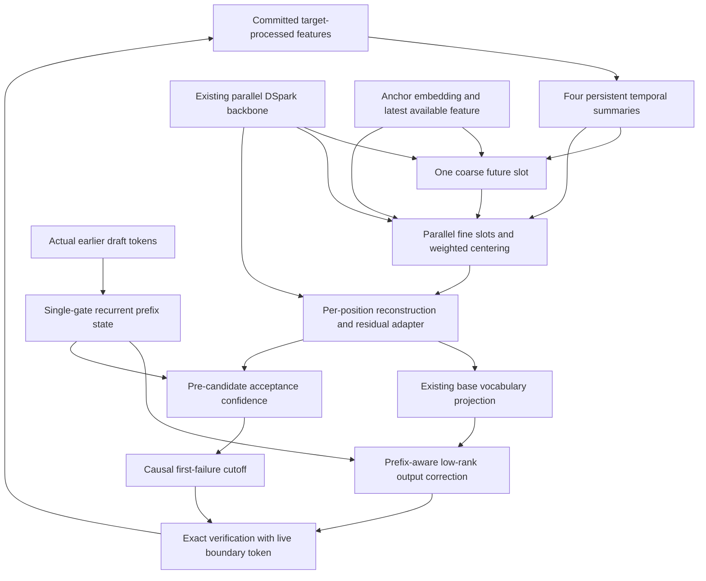

# NCM-inspired persistent-memory draft head with native confidence cutoff

Status: **Architecture revision 4; random labels remain the baseline. Learned labels are specified but unimplemented. The user's separate authorization covers capture; this document does not authorize training.**

Revision 4 retains revision 3's runtime architecture and random-projection baseline, and adds the concrete learned continuous encoder/decoder alternative in §13a in response to the [Astra tokenizer review][REVIEW3]. It does not replace the baseline or implement the alternative. Revision 3 incorporated the [second GPT-6 Astra review][REVIEW2] while preserving the cutoff contract from the [first review][REVIEW]. Earlier reviews' line references describe their respective historical revisions. The EMA-only adapter remains a named alternative.

Date: 2026-10-18. Local code inspected at `d82ae69d0368478b5018d4cbfa92ab4643a43f54`. Source links and line numbers describe that checkout, not a guarantee about future revisions.

This is an architecture plan, not an execution task graph. It deliberately excludes dataset sizes, experiment arms, benchmark thresholds, training schedules, deployment commands, and a performance claim. The user requested that the design be solidified before designing the experiment.

**Companion added 2026-10-18:** the user's subsequent request to design the experiments is addressed in the [staged experiment plan](/Users/dnikolaidis/Desktop/divix/sglang-nvfp4/docs/hx/ncm-head-experiments.draft.md). Earlier deferrals below describe the scope and history of this architecture document. The companion now contains the corrected experimental protocol. The user subsequently authorized direct setup without hx: an isolated CPU-tested reference implementation and an unrun native weight/gradient probe are described in [the setup runbook](/Users/dnikolaidis/Desktop/divix/sglang-nvfp4/analysis/ncm_head/README.md). No model capture, native GPU probe, training experiment or serving experiment has run. Revision 3's architecture is unchanged; native serving integration remains pending.

The working name “NCM head” refers to the proposed head in this conversation. The design borrows NCM's prediction of coarse future structure followed by parallel finer residual predictions. It does **not** reproduce NCM's residual VQ hierarchy or sampled latent factorization. Persistent temporal memory and the short continuous future hierarchy are distinct components; both remain unvalidated for speculative acceptance.

**Current authorization and status, revision 4:** the user authorized updating this design and starting capture after native preparation. A concrete eager collector and 44 passing CPU checks exist in the `codex/ncm-capture-wiring` worktree based on local master `ee528f2c747e5cf598b9c0fc91b0c9d5fa3d70d9`. The historical companion note above describes an earlier setup stage. Native validation and capture status belong in the [current runbook](../../analysis/ncm_head/README.md); this plan does not certify execution. Capture retains full projected future features independently of the random label projection. Learned-encoder training and head training are not started by this design update. Engram reuse is excluded by the user.

## Goal

Use a compact, persistent representation of the prompt and committed response to condition future-token proposals, while natively predicting when additional speculative verification is unlikely to be useful. Preserve the target model's output semantics through correct greedy or sampled verification, including when the confidence policy truncates the proposal.

## Acceptance criteria

These are architecture-completeness criteria, not experiment success criteria.

- The design defines memory inputs, state, update equations, precision, lifecycle, and the exact causal boundary at which a token may enter memory.
- The design defines how a shared plan changes the token proposal, including the ordinary token vocabulary and the proposal probabilities required for sampled verification.
- The head natively emits per-position conditional acceptance confidence; a threshold policy can omit a low-confidence suffix before expensive verification work. A product score is never mislabeled as an exact prefix-survival probability.
- The planner defines fixed coarse/fine future targets, a token-weighted zero-mean residual reconstruction, EOS/truncation semantics, and inference-only prefix inputs. Both token and confidence branches can distinguish sampled prefixes beyond their last token.
- A sampled cutoff cannot inspect the token whose admission it decides, later draft tokens, or current verification outcomes; the document specifies the resulting stopping rule.
- The architecture supports zero admitted drafts, partial admission, and full admission, with correct bonus/correction handling and committed-state updates.
- Every substantive component has a cited basis or is explicitly identified as an engineering proposal without empirical support.
- The Sol paper summary is preserved as a linked source, with paper findings separated from this design's hypotheses.

## Decisions

- **User requirement U1:** write a detailed architecture plan with references to the GPT-6.1 Sol paper summary and the reason/evidence for each component; defer experiment design.
- **User requirement U2:** native DSpark-style confidence cutoff is essential. The exact Markov implementation is not mandatory. The head must support stopping verification of a suffix when confidence is below a threshold.
- **User requirement U3:** incorporate Astra's future residual planner, prefix-aware head, corrected sampled cutoff, and evidence/rationale; leave experiments for later.
- **User requirement U4:** incorporate the second review's fixed residual targets, token-weighted zero-mean fine residuals, EOS/truncation semantics, single-gate prefix state, and label-alignment corrections, retaining evidence and deferring experiments.
- **User requirement U5:** incorporate Astra's learned-tokenizer corrections and a concrete encoder/decoder learning contract; retain random projection as the baseline, exclude Engram reuse, then start capture under the separate execution workflow.
- **Revision 4 decision:** the alternative learns and freezes a training-only continuous label encoder. Its auxiliary reconstruction decoder is discarded; runtime head initialization and predicted-latent training stay aligned with the baseline. No superiority, semantic-code or acceptance claim follows from reconstruction alone.
- **Proposed revision 3:** retain one existing parallel backbone pass and token vocabulary. Predict one coarse future slot and up to four parallel finer residual slots, then inject their reconstruction before the existing vocabulary projection.
- **Proposed revision 3:** retain four persistent temporal slots, width 128, with timescales 8, 32, 128, and 512 processed tokens; use FP32 accumulators, mass normalization, and a processed-token watermark. These numeric choices are hypotheses, not paper-derived optima.
- **Proposed revision 3:** use a trainable compact **single-gate** recurrent draft-prefix state in the output head and confidence branch. Reuse the existing low-rank vocabulary-correction shape; Markov alone remains an alternative.
- **Proposed revision 3:** use deterministic continuous planning, direct anchor conditioning, fixed global/local future targets, and token-weighted zero-mean fine residuals. The planner has a fixed horizon, explicit terminal padding after EOS, and no substitution of shortened means for unknown labels.
- **Proposed revision 3:** retain token fidelity and acceptance-aligned distribution matching with separately defined reference and actual-prefix conditioning. No sampled concept variable, codebook, or additional full transformer pass.
- **Proposed revision 3:** default to calibrated **conditional acceptance** thresholds. An optional cumulative product is named `monotone_admission_score`, without a probability guarantee. Direct prefix-survival prediction is a separate deferred extension.
- **Proposed revision 3:** native confidence and verification truncation are required. Fallbacks obey the same causal admission rule; no suffix observation may reopen a stop.
- **Proposed revision 3:** select threshold values and calibration fitting procedures later. No value such as `0.4` is inherited from unrelated proxy gates.

## Rules

- All target and draft conditioning must be available at the real inference boundary; teacher-forced future hidden states are labels or diagnostic material only.
- Persistent memory contains only committed, target-processed input tokens. Proposed, rejected, padded, and merely sampled-but-not-processed tokens cannot advance it.
- Memory state is request-specific and identified by request generation, processed-prefix position, model/checkpoint identity, and memory-architecture identity.
- Memory is updated once per actual processed token, not once per draft round; graph padding and batching must not change its logical meaning.
- Token confidence means expected acceptance under the selected verifier and sampling regime, not token softmax probability or semantic plausibility.
- A truncation decision selects a contiguous prefix. Neither later high confidence nor a later invalid value can reopen admission after a stop.
- Verifier probabilities must correspond to the actual modified proposal, including the applicable sampling transformations. Old DSpark logits cannot verify newly modified proposals.
- Native cutoff requires avoiding or masking real suffix work; discarding results after a full-width verify is not sufficient to claim a verification-cost saving.
- No existing confidence calibration is presumed valid after changing the draft head.
- Paper results, local-code observations, historical memory, and new design assumptions must remain visibly distinct.

## Non-goals

- Designing or running the acceptance experiment, collecting data, selecting a training budget, or setting a ship threshold.
- Replacing the target model's tokenizer, weights, KV cache, or sampling distribution.
- Claiming that four exponentially weighted summaries are NCM's multiscale residual quantizer.
- Guaranteeing permanent retention of the original prompt: all four proposed memory slots decay.
- Adding a separate raw-text encoder, storing all past hidden states at runtime, or adding another recent-token ring buffer in this revision. Existing DSpark context remains the detailed path.
- Reusing NCM's released generator or tokenizer checkpoint as a drop-in head.
- Requiring the existing Markov machinery; its factorization is a useful initialization and cost reference, not the cutoff contract.
- Implementing a new scheduler, graph layout, or online calibration policy in this documentation task.

## Open questions

- **Q1:** finalize the target/checkpoint-specific feature alignment and teacher-feature dimensions before implementation. The mathematical alignment is specified below; concrete model indices remain an integration decision.
- **Q2:** determine whether a future direct prefix-survival predictor is needed beyond the default conditional threshold. It is not required for this revision's native cutoff.
- **Q3:** confirm the intended first target/checkpoint and enabled serving path before implementation. The code survey covers the local DeepSeek DSpark integration; it does not establish that every graph/sampling backend has the required cutoff behavior.
- **Q4:** confirm whether long-lived prompt retention must exceed the proposed longest decay timescale. If it must, an additional prompt-only/static summary requires a deliberate revision, not an implicit claim that the 512-token slot is permanent memory.

These questions do not prevent review of the concrete default proposed below. They identify decisions the user has not yet approved.

## Design

### 1. Evidence map and limits

The companion [GPT-6.1 Sol extraction][SUMMARY] is the main NCM evidence index. Its section IDs refer to printed PDF pages and distinguish extraction from inference.

| Evidence | What it supports | What it does not establish |
| --- | --- | --- |
| [Sol S1][N1], paper §3, pp. 5–7 | A shared coarse representation can condition many finer predictions. | That persistent EMA memory or a single continuous plan improves speculation. |
| [Sol S2][N2], paper training and exposure mismatch | Future-derived supervision must be separated from available conditioning; robustness to imperfect latent inputs matters. | A particular training recipe for this head. |
| [Sol S3–S4][N3], 8–32 calls and few-level ablations | Reusing the complete NCM hierarchy would add substantial serial work; one/two stages are not validated. | That our two compact stages preserve NCM quality or improve acceptance. |
| [Sol S5][N5], token reconstruction | Exact lexical detail matters; semantic reconstruction is insufficient. | Target-model acceptance from reconstruction accuracy. |
| [Sol S7–S8][N7], shared-structure probes and hypotheses | A shared representation is worth considering, while retaining token-level dependencies. | Named interpretable concepts or a measured serving gain. |
| [DFlash §4.1][DF] | Existing draft context already reuses target features; the new module must add value beyond that access. | That the current drafter sees only its latest hidden state. |
| [DSpark §3.1–3.2][DS] | Separate token-dependency, confidence, and verification-admission roles. | A requirement to preserve a particular Markov implementation. |
| [Local model projection/head][C1], [sampler][C2], [KV injection][C3], [verification][C4] | Concrete integration surfaces and the need to preserve sampling/commit semantics. | That the proposed module or all cutoff paths are already implemented. |
| [Astra R1–R6 and mathematical review][REVIEW] | Causal fallback correction, local-overlap semantics, future residual planning, prefix-state expressivity, and direct anchor access. | An empirical acceptance or speedup result. |
| [Astra second review R2-1–R2-5][REVIEW2] | Fixed residual labels, enforced global/local decomposition, consistent horizon, simpler recurrence, and separate label-conditioning paths. | A measured advantage of the planner or single-gate cell. |

> 🧠 **From Hindsight memory (DSpark confidence-head verify cut on the EXL3 static graph)** — Earlier work records confidence-based suffix truncation and a sampled stopping rule that avoids reading the current candidate when deciding its admission. This is historical design context, not proof that every branch change is in this checkout.

> 🧠 **From Hindsight memory (DSpark sampled path: finish the confidence cut and block verification (F142))** — The retrieved record distinguishes reported kernel/distribution checks from a completed served A/B result; it does not establish a completed served outcome. This is historical context only and supplies no performance claim for this new head.

The present source contains cutoff lengths in greedy and sampled acceptance and a `CapCorrectLen` implementation [C4][C5]. That establishes an interface to investigate, not a proof of end-to-end cutoff correctness or useful work avoidance.

### 2. Overall data flow



The two planner stages finish before token sampling. Fine-slot predictions are parallel, followed by a small token-weighted centering reduction; position adapters are parallel. The small output head is sequential because it conditions on actual earlier draws. Confidence reads that same state **before** the current draw. Memory is written only after verification resolves committed processed rows.

**Basis:** future residual structure follows [N1][N2] as adapted by Astra R2; prefix state addresses R4, direct anchor conditioning R5, and the cutoff preserves U2 while addressing R1/R3 [REVIEW]. The combination and its widths are proposed, not measured.

### 3. Shapes, terminology, and causal boundary

Let `N` be request batch size, `gamma >= 1` the maximum draft candidate count, `d_ctx` the frozen projected target-feature width, `d_draft` the collapsed backbone width, `d_embed` the shared token-embedding width, `V` vocabulary size, `r = 128`, and `k` the existing Markov correction rank. `J = min(4, gamma)` is the number of fine slots. Width and slot counts are concrete starting choices, not optima from NCM.

| Value | Shape per request | Meaning |
| --- | --- | --- |
| `F_t`, `u_t` | `[d_ctx]`, `[r]` | Committed processed target feature and learned compact encoding |
| `a_s`, `b_s`, `m_s` | `[4,r]`, `[4]`, `[4,r]` | FP32 accumulators, normalization masses, normalized memory |
| `u_last` | `[r]` | Last processed committed compact feature |
| `h_i`, `d_i` | `[gamma,d_draft]`, `[gamma,r]` | Frozen backbone features and compact projection |
| `z0`, `raw_j`, `Delta_j` | `[r]`, `[J,r]`, `[J,r]` | Coarse prediction, raw fine outputs, and centered fine residuals |
| `w_j` | `[J]` | Fixed segment token counts divided by `gamma`; weights sum to one |
| `z_i`, `r_i` | `[gamma,r]` each | Per-position future reconstruction and token adapter output |
| `s_i` | `[r]` | Ephemeral state of the sampled prefix before candidate `i` |
| `v_i` | `[k]` | Low-rank vocabulary-correction feature |
| `q_i` | `[gamma,V]` conceptually | Actual proposal after output correction and sampling transforms |
| `c_i`, `A_i` | `[gamma]` each | Conditional acceptance estimate and optional monotone score |
| `ell`, `verify_width` | scalar integers | Admitted candidates and `1 + ell` input rows |

`gamma` counts candidates, not anchor-plus-candidates. Resolve model-specific anchor alignment [C2]. The prefix may end with a known anchor token whose target hidden state does not yet exist. Memory ends at the latest **processed** committed token; the anchor enters through its embedding. No extra target forward is required. All ledger positions are logical token offsets, not physical KV locations.

The future planner is proposal-local and deterministic given the committed context, anchor, fixed backbone positions, and memory snapshot. `s_i` is also proposal-local: it is reset each round and updated from draft tokens. It never enters persistent memory directly. A stopped or rejected suffix cannot update committed state.

**Basis:** feature availability follows [C1][C2], future-input exclusion [N2], and persistent/ephemeral separation is a derived causality requirement. See Astra R2/R4 [REVIEW].

### 4. Feature source and memory encoder

Use the output of the frozen target-to-draft projection already computed for context injection (`project_target_hidden`), rather than collecting additional target layers or encoding raw text separately [C1]. Project it once for each new committed row:

```text
x_t = W_in * RMSNorm(F_t)                         # d_ctx -> r
u_t = W_u2 * SiLU(W_u1 * x_t)                     # r -> 2r -> r
```

The new RMSNorm operations use fixed epsilon `1e-6` and no learned scale in revision 3. New matrices are bias-free unless a scalar confidence bias is explicitly defined. Existing model normalization stays unchanged.

The memory encoder is trainable; the upstream target feature projection remains frozen. Do not persist all raw target features at serving time. Reuse of the projected tensor must follow committed-row masking, even if the upstream projection runs on a larger speculative tensor.

**Reason:** use information the target has already computed while bounding added per-token cost. [DF] motivates target-feature conditioning and [C1] supplies the concrete source. The particular bottleneck, activation, and normalization are proposed implementation choices. They are not proven superior to linear pooling or a recurrent encoder.

### 5. Persistent memory update and precision

For each actual new token, in token order, update four slots:

```text
tau   = [8, 32, 128, 512]
alpha = exp(-1 / tau)
a_s   = alpha_s * a_s + (1 - alpha_s) * float32(u_t)
b_s   = alpha_s * b_s + (1 - alpha_s)
m_s   = a_s / b_s                                # only when state is nonempty
```

Initialize `a_s = 0`, `b_s = 0`, and the processed-token count to zero. Empty state produces zero memory reads and `u_last = 0`, with an explicit `memory_present = false` flag; never divide by zero mass. The planner still has the anchor and backbone context. Confidence truncation is enabled only if its artifact supports this empty-memory regime, otherwise it is disabled before drafting. Normalizing by `b_s` prevents long-timescale slots from initially looking small merely because the request has few tokens.

Keep decay coefficients, accumulation, mass, and updates in FP32. Cast normalized values to the adapter compute dtype only at readout. At a 512-token timescale, `1-alpha` is approximately 0.00195, smaller than BF16 relative spacing near unity; repeatedly storing the state in BF16 can erase small updates. This is a numerical engineering argument, not an NCM result.

Logical updates are per token, regardless of verify width. For a chunk of `k` new rows, the equivalent accumulator is:

```text
a_after = alpha^k * a_before
          + (1-alpha) * sum_j alpha^(k-j) * u_j
```

An implementation may use a scan or chunk reduction, but must preserve ordering and establish floating-point tolerance against a canonical tokenwise recurrence. Do not replace the sequence by an unweighted chunk average or decay once per verify.

Four FP32 accumulators require 2,048 bytes; masses add 16 bytes; `u_last` adds 512 bytes. The core floating state is **2,576 bytes per request**, before identity metadata, alignment, transaction buffers, and temporary activations. This replaces the earlier illustrative 1 KiB BF16 estimate.

**Reason:** multiple fixed timescales give a cheap, bounded way to retain recent and older context; scalar recurrence also makes state independent of arbitrary round boundaries. These temporal scales are **not** NCM's coarse-to-fine residual levels [N1]. Four slots, their decay values, startup normalization, and FP32 storage are proposed choices based on simplicity, continuity, and numerical behavior.

**Limit:** these summaries lose detailed token order and decay old prompt contributions. They are not permanent topic memory, a retrieval index, or a lossless compressed prefix. Existing DSpark context remains essential [DF].

### 6. Deterministic future residual planner

This replaces the single four-value readout as the primary design. Temporal memory summarizes the past; the planner predicts a compact hierarchy of **future** features. It uses two small sequential stages, with no extra transformer invocation.

First project all backbone positions in parallel and define a memory read:

```text
d_i       = W_down * RMSNorm(h_i)                    # d_draft -> r
anchor_r  = W_embed * frozen_embedding(anchor)      # d_embed -> r
key_s     = W_key * RMSNorm(m_s + scale_embed_s)
value_s   = W_value * RMSNorm(m_s)
Read(q)   = sum_s softmax(q dot key_s / sqrt(r)) * value_s
```

Memory attention has four keys and FP32 softmax. Empty memory returns zero. The direct anchor path below is essential: it must not affect only attention weights. All new MLPs use SiLU with hidden width `2r`; `MLP_n` denotes `nr -> 2r -> r`. Unless specified otherwise, new matrices are bias-free and new RMSNorms retain §4's convention.

Partition the fixed draft positions into `J` contiguous nonempty segments using `segment(i) = floor((i-1)*J/gamma)`, indexed `0..J-1`. Let `n_j` be the number of positions in segment `j`, and `w_j = n_j/gamma`. These weights are fixed by the proposal horizon, never by future EOS or label masks. Let `pool` and `pool_j` be means over the whole block and segment `j`, respectively. They operate on available backbone features, not candidate identities or future target states.

```text
q0       = W_q0 * concat(anchor_r, u_last, pool(d))       # 3r -> r
z0       = MLP_4(concat(anchor_r, u_last, pool(d), Read(q0)))
q_j      = W_qf * concat(z0, pool_j(d), segment_embed_j)  # 3r -> r
raw_j    = MLP_6(concat(z0, pool_j(d), anchor_r,
                       u_last, Read(q_j), segment_embed_j))
mean_raw = sum_j w_j * raw_j
Delta_j  = raw_j - mean_raw
z_i      = z0 + Delta_segment(i)
```

All `raw_j` predictions run in parallel after `z0`, then a small reduction centers them. Distinct segment queries provide position-specific memory access. The coarse prediction is a direct input to the finer predictor and to reconstruction. By construction, `sum_j w_j*Delta_j = 0` and `sum_j w_j*(z0+Delta_j) = z0`: the fine stage cannot cancel the global component with a common offset. Use token-count weights, not `1/J`; for `gamma=5,J=4`, segment sizes are `2,1,1,1`. With `J=1`, the fine residual is identically zero and its unused computation may be bypassed.

`z0`, all residuals, and `z_i` remain fixed through drafting. Position-level lexical detail remains available through `d_i` and the token path. The two stages add hierarchical computation, not additional observed information. They predict multiscale future-feature statistics; they do not resolve a sampled future mode as NCM's stochastic coarse codes can.

The slots have fixed future targets in §13. The centering constraint enforces a global/local decomposition; the losses encourage correspondence to future features. Neither guarantees identifiable concepts, token-level sufficiency, or acceptance gains. In particular, the decoder can still ignore an unhelpful plan.

**Basis:** NCM predicts coarse content and reconstructs progressively finer residuals [N1], with training/inference mismatch addressed in [N2]. Astra R2/R5 recommends retaining that structure and removing the anchor-only routing bottleneck [REVIEW]. Two compact stages, continuous rather than VQ latents, mean pooling, piecewise-constant reconstruction, width 128, and up to four segments are new hypotheses. Token-weighted centering follows Astra R2-2 [REVIEW2] and enforces the stated decomposition; it is our adaptation, not a reported NCM operation. The paper does not validate this shallow target-conditioned design [N4].

### 7. Token adapter and prefix-aware output head

Apply one parallel residual adapter before the existing final norm and shared vocabulary projection:

```text
r_i   = MLP_3(concat(d_i, z_i, pos_i))               # 3r -> 2r -> r
h'_i  = h_i + W_up * r_i                             # r -> d_draft
U_i   = existing_vocab_head(existing_norm(h'_i))
```

`pos_i` is an r-dimensional draft-position embedding. Initialize `W_up = 0`; do not zero every upstream matrix. Existing target vocabulary, embedding, and shared LM-head weights stay frozen. There is one base vocabulary projection over the block, as before.

The output dependency module has a compact recurrent state. Its low-rank correction reuses the existing Markov-shaped tables as **trainable draft-owned copies**, initialized from their original values:

```text
E_dep       : [V,k]       # initialized from existing Markov embedding
W_dep       : [V,k]       # initialized from existing Markov output matrix
P_state     : [k,r]       # initialized to zero
s_1         = MLP_2(concat(z0, anchor_r))
previous_i  = anchor if i == 1 else y_(i-1)
v_i         = E_dep(previous_i) + P_state * s_i
logits_i    = U_i + W_dep * v_i
q_i         = actual_normalized_proposal(logits_i, sampling_settings)
```

Only after admission and sampling `y_i`, update the prefix state:

```text
x_i              = concat(W_embed * frozen_embedding(y_i), d_i, z_i)  # 3r
[g_pre, b_pre]    = W_joint * concat(x_i, s_i)                        # 4r -> 2r
g_i              = sigmoid(g_pre)
b_i              = tanh(b_pre)
s_(i+1)          = g_i * s_i + (1-g_i) * b_i
```

This is a bias-free single-gate recurrent cell of width `r`, with `W_joint` of shape `[2r,4r]`. Gate and candidate share one dense phase, avoiding the prior reset-gate-to-candidate matrix dependency. The cell still has state-dependent gating and nonlinear prefix memory. All state is ephemeral; a partially sampled prefix never becomes committed target history. The low-rank correction replaces the existing Markov correction, rather than adding another full vocabulary projection per step. Skip the update after the final candidate when no later consumer needs that state.

At initialization `W_up=0` and `P_state=0` recover the original token logits algebraically with copied dependency weights. Training can then change both the recurrent correction and dependency tables. The recurrent gate weights are not zero-initialized. Numerical parity and token-draw parity require the same kernels, sampling transformations, and randomness semantics; algebra alone is not a runtime guarantee.

Two histories such as `A C` and `B C` can now leave different `s_i` values even though their predecessors match. The original first-order head cannot distinguish them at fixed context and position. This is an expressivity benefit, not a measured acceptance gain. Markov-only remains a cheaper alternative; widening adaptation into backbone layers is deferred.

**Basis:** exact lexical output and a direct token path follow [N5]; the insertion and existing low-rank projection are in [C1][C2]. Astra R4 establishes the same-last-token limitation and recommends prefix-aware state [REVIEW]. Astra R2-4 [REVIEW2] recommends a single-gate realization because prefix awareness does not require the extra reset-before dependency. Initialization, rank reuse, and freeze policy remain engineering choices. This simpler cell is not a speedup claim; more sequential capacity may still cost more than it gains.

### 8. Native prefix-aware confidence head

The head predicts acceptance **before observing the candidate being admitted**, using the same prefix state and correction feature as the proposal:

```text
v_compact = W_vconf * stop_gradient(v_i)             # k -> r; confidence-owned projection
features  = concat(stop_gradient(concat(d_i, r_i, z_i, pos_i, s_i)),
                   v_compact, sampling_features)
raw_i     = w_conf * SiLU(W_conf * features) + b_conf
c_i       = sigmoid(raw_i / calibration_temperature[i, regime])
```

`W_conf` maps `6r + f_sampling` to `r`. Temperatures must be finite and positive. The confidence-only projection `W_vconf` is trained by the confidence loss: its source `v_i` is detached before that projection, while the other token/planner features are detached at the confidence branch boundary. Confidence-owned parameters retain gradients.

The versioned sampling schema includes target/proposal greedy or sampled mode, effective temperatures and top-k/top-p settings with inactive flags, any other supported probability transformations, and `memory_present`. Additional history-dependent sampling rules must have explicit proposal semantics and confidence support; unsupported regimes disable cutoff before drafting. The verifier always receives the actual normalized proposal, not an approximation inferred from these features.

Confidence training cannot update the token/planner/prefix modules. Token and planning losses train those modules independently. The confidence head must be retrained/recalibrated for the changed proposal and actual-prefix state; interface compatibility does not imply the old predictor remains sufficient.

`c_i` is not `max(q_i)`, `q_i(y_i)`, semantic plausibility, or latent similarity. It describes the expected success of the next draw under the verifier. In particular, `q_i(y_i)` is unavailable to the decision that admits `y_i`.

**Basis:** U2 and Astra R3/R4 require native, proposal-aware confidence [REVIEW]. The branch size, detached-gradient boundary, and settings schema are engineering choices. Acceptance-overlap supervision has a direct precedent in [DS]; NCM does not supply this machinery.

### 9. Confidence supervision, score semantics, and calibration

At the same actual draft prefix, let `p_i` and `q_i` be normalized target and proposal distributions including all effective sampling transforms. For sampled rejection verification, supervise next-position confidence with:

```text
c*_i = sum_v min(p_i(v), q_i(v))
     = 1 - 0.5 * sum_v abs(p_i(v) - q_i(v))
```

For greedy draft plus greedy target verification, use the indicator that the selected draft token equals the target argmax under the declared tie-breaking rule. A deterministic draft with a sampled target is a different regime: its proposal is a point mass and its overlap label follows the general formula. Never silently use greedy labels for sampled acceptance.

Target distributions are offline labels or verification outputs, not live inputs to admission. Labels must use the same actual draft prefix as the proposal; replacing it with a different teacher continuation changes the quantity being learned. Soft-label binary cross-entropy is the confidence objective. Fitting methods, data production, and schedules are deferred.

The default policy uses calibrated `c_i` directly. An optional product is defined only as:

```text
A_0 = 1
A_i = A_(i-1) * c_i        # monotone_admission_score; not exact prefix survival
```

Even perfect local overlaps do not make this a survival probability. For `p1=(.9,.1)`, `q1=(.5,.5)`, local overlap is `.6`. If next-step overlap is `1` after A and `.2` after B, true two-token survival is `.5*1 + .1*.2 = .52`, whereas the mean local-overlap product is `.6*(.5*1+.5*.2)=.36`. See the proof and counterexample in [Astra R3][REVIEW].

Before drawing candidate `i`, the true survival probability conditional on the earlier realized candidates is the product of their candidate-specific acceptance ratios times the next-position overlap. Those ratios require target information unavailable to this runtime predictor. A direct prefix-survival predictor could learn that event from appropriate offline soft labels or acceptance outcomes, using only pre-candidate features; it is a deferred extension, not an alias for `A_i`. Its forecast need not decrease as favorable prefix information arrives.

Calibration artifacts identify the target and draft checkpoints, memory/planner/dependency weights, confidence weights, maximum width, verifier semantics, supported sampling transformations, score meaning, and calibration version. Store raw logits separately from `c_i` and `A_i`. Calibrate conditional confidence against its actual overlap target on relevant draft-prefix distributions; product-score diagnostics are separate. Calibration is about useful decisions, not the exactness proof.

A missing or mismatched artifact determined from prefix-only metadata disables truncation before drafting. A candidate-dependent validity issue obeys §10's sequential fallback; it cannot trigger a whole-vector retrospective reset.

**Basis:** the overlap identity follows rejection sampling and motivates [DS]'s supervision. The local-versus-prefix distinction and counterexample are mathematical findings in [REVIEW]. Versioned artifacts and separate schemas are engineering requirements for interpretable estimates, not prerequisites for target-distribution exactness.

### 10. Causal admission and fallback state machine

“Stop verification early” means deciding a contiguous useful prefix before costly target work. It need not interrupt a transformer midway through its layers. The default is **conditional acceptance thresholding**:

| Mode | Next admission condition | Threshold meaning |
| --- | --- | --- |
| `conditional_acceptance` — default | `c_i >= theta` | Estimated acceptance probability of the next proposal at the current draft prefix |
| `monotone_admission_score` — optional | `A_i >= theta` | Product-score threshold, explicitly without a prefix-probability guarantee |

`theta` lies in `[0,1]` and equality admits. `theta=0` admits all valid finite scores. Stop permanently at the first failure; high later confidence cannot reopen it.

Use three states: `ACTIVE`, `FULL_REMAINDER`, and `STOPPED`. Prefix-only metadata may initialize `FULL_REMAINDER` before token sampling. An invalid confidence at the **next visited** position changes `ACTIVE` to `FULL_REMAINDER`. Once `STOPPED`, no confidence, candidate, or validity flag in the suffix is inspected by this policy.

```text
mode = ACTIVE if prefix_metadata_supports_cutoff else FULL_REMAINDER
ell = 0
A = 1
s = initialize_prefix_state()
for i in 1..gamma:
    form logits_i and valid normalized q_i from fixed plan and prefix state s
    # Invalid q is a proposal error, not a confidence fallback; see below.
    if mode == ACTIVE:
        c_i = calibrated_confidence(pre_candidate_features)
        if not finite_and_in_unit_interval(c_i):
            mode = FULL_REMAINDER
        else:
            next_A = A * c_i
            if selected_threshold_fails(c_i, next_A):
                mode = STOPPED
                break
            A = next_A
    admit position i
    y_i = sample_or_select(q_i)
    s = update_prefix_state(s, y_i, d_i, z_i)
    ell = i
verify_width = 1 + ell
```

`FULL_REMAINDER` ignores subsequent confidence values and admits the remaining valid proposals. It does not revisit past decisions. The required invariants are:

- Admission of `i` may use the fixed prefix/plans, earlier sampled candidates, and declared metadata, but not `y_i`, `q_i(y_i)`, later candidates/confidences, current-round target outputs, or acceptance uniforms.
- No `any_nonfinite(full_confidence_vector)` or other suffix reduction may override an earlier stop.
- Request-wide calibration/support checks happen before drafting when based on request metadata. Any position-dependent check happens only when causally visited.
- Memory validity and selection of the original-head fallback occur from the committed snapshot before drafting. They do not change the head after candidate inspection.
- Physical whole-block generation is allowed only if the observed proposal and admission decisions are equivalent to this logical loop. Do not rerun a shorter bidirectional backbone and substitute different probabilities for already drawn tokens.

The unsafe fallback example in [REVIEW] has `p1=q1=(.5,.5)`, a low first confidence, and a later NaN iff the first candidate is A. Reopening admission on that suffix NaN changes `P(output=A)` to `.75`. Our state machine never visits that NaN after stopping.

If `q_i` is nonfinite, unnormalized, or does not match the draw process, do not continue verification pretending it is valid. A failure detected before drawing `i` may terminate admission at the already valid prefix and use a fresh target boundary draw. For an error discovered only after sampling or in an unvisited suffix, do not silently switch to a different output path based on that observation; surface an execution error under the backend's recovery contract. This design makes no exactness claim for sampling from an invalid distribution.

**Exactness argument:** at an admitted position, accepted candidate mass is `min(p_i(v),q_i(v))` and rejected/corrected mass is `(p_i(v)-q_i(v))_+`; their sum is `p_i(v)`. At a cutoff, a valid boundary sample also follows `p_i`. With appropriate independent draw/acceptance/correction randomness, induction preserves target sampling under predictable stopping. Calibration errors can change efficiency without changing this identity. Non-anticipation is the sufficient general contract for this unchanged verifier, not a claim that every conceivable selection-aware sampler must use it.

**Basis:** U2 requires native cutoff; [DS] §3.2.2 discusses retrospective selection bias. Astra R1 and the exactness proof in [REVIEW] motivate this explicit state machine. An optional future cost-aware policy must retain these causal boundaries; no such scheduler is designed here.

### 11. Verification, boundary token, and real work avoidance

`ell` counts admitted candidates; target input width is `1+ell`, including the anchor. Rejection emits the verifier's residual correction at the first rejected candidate. If all admitted candidates pass, the last live target row supplies a continuation. `ell=0` still processes the anchor and emits one target token.

Two boundary constructions are permitted:

1. Sample a fresh target continuation from the cutoff boundary distribution.
2. Use a valid rejection step on an additional proposal at that boundary and retain its accepted-or-corrected token. Its mixture is target-distributed even though it is counted as the boundary output rather than an admitted draft.

The inspected sampled implementation caps the accepted count and gathers `predicts[accept_index[capped_count]]` [C8]. Together with the rejection kernel's writes [C9], this can implement construction 2. It is not automatically biased just because capping follows a full chain. Keeping an unrelated bonus from a farther discarded prefix would be wrong. Correctness still requires predictable admission, matching proposal probabilities, valid live boundary logits, and appropriate randomness; this is not a blanket endorsement of every backend.

The default architecture permits packed narrower verification or fixed-shape verification with live-row masking that suppresses actual suffix work. Candidate-buffer placeholders, dead-row logits, and NaNs cannot affect a live correction/bonus, KV state, or memory. The backend must distinguish work really avoided from dense padded work that remains. Computing a full target block and merely discarding suffix results does not meet the cost-saving requirement.

Confidence values never replace `p_i` or `q_i`. Use the modified planner-plus-prefix-head proposal with its actual sampling transforms. A new head cannot be verified with old DSpark logits.

**Basis:** the boundary-mixture proof and local-code interpretation are in [REVIEW]; interfaces and implementation are [C4][C5][C8][C9]. U2 supplies the real work-avoidance requirement; [C7] is a potential integration surface, not evidence of complete backend coverage.

### 12. State lifecycle and transaction boundaries

Use a state record containing accumulators, masses, `u_last`, request-generation identity, a processed-token watermark, and model/adapter identity. A proposal reads a stable snapshot. No draft pass mutates persistent state.

| Event | Required action |
| --- | --- |
| New request | Allocate/reset an empty record; do not inherit a recycled request slot. |
| Prefill | Consume actual input-token features in logical order. Chunk boundaries do not reset state. |
| Draft | Read snapshot, produce plan/token/confidence outputs; no memory commit. |
| Verify completion | Resolve acceptance and cutoff first, then ingest only newly committed processed input rows. |
| Rejected draft suffix | Discard its hidden states and do not advance memory. |
| Newly emitted correction/bonus | Its ID may be queried as an anchor; ingest its target feature only after processing it later. |
| Padding/dead rows | Do not decay, update mass, change `u_last`, or advance watermark. |
| Retry/double callback | Watermark and request generation prevent ingesting a row twice. |
| Request cancellation/completion | Release the record and invalidate its generation. |
| Fork/beam or migration | Copy/transfer state and metadata with the exact corresponding prefix, or reject unsupported operation. |
| Prefix-cache hit/resume | Restore a matching memory sidecar, or reconstruct memory from compatible prefix features. KV bytes alone are not a valid reconstruction source. |

Example: the prior memory ends at token `t`; the known anchor is token `t+1`. Verification processes the anchor and admitted candidates. If two candidates survive and the third is replaced, commit memory features through the second accepted candidate. Do not commit the rejected third candidate's hidden state. The newly emitted replacement is the next anchor and has no committed target feature yet.

Resolve shared metadata with KV commit machinery, but do not derive semantic commit lengths from a physical KV sentinel alone. Verify the same accepted-prefix convention in eager, folded, and graphed paths. The current injector has a commit mask [C3]; wiring the new state into all paths remains implementation work.

Check memory validity on the committed snapshot before creating the proposal. Nonfinite memory selects the original unmodified draft head and disables confidence truncation for that proposal until state is rebuilt. Record the selected head identity and its actual probabilities. Never switch head identity after inspecting candidates or silently attach poisoned state to another request. Ordinary empty memory is handled by §5, not treated as corruption. Rebuild failures are explicit; they do not authorize retrospective admission changes.

**Basis:** committed-row filtering exists in [C3]. Idempotence, transactionality, and sidecar identity are derived requirements of persistent state. They are not reported NCM mechanisms.

### 13. Learning contracts, including future residual targets

Freeze the target, shared token embedding and LM head, DSpark backbone, and target-to-draft feature projection. Train the memory encoder/readout, compact backbone projection, planner, token adapter, position/segment embeddings, recurrent prefix module, and draft-owned dependency tables. Train the confidence branch with detached token/planner inputs. No target-model retraining is required. Fine-tuning selected backbone layers is a later architecture extension, not part of this revision.

#### Fixed future-feature label space and reference law

For the default `random-v1` baseline, define a frozen `P_label: d_ctx -> r` by drawing independent standard-normal entries, then dividing each row by its L2 norm, with no further scale multiplier. Generate it once with a recorded RNG algorithm and seed; serialize its FP32 weights and checksum as the authoritative artifact rather than assuming cross-library seed parity. It is a training-only map, never updated by losses. Use the frozen projected target features from §4, recording the target checkpoint, feature-layer selection, projection identity, dimensions, and RMS normalization epsilon `1e-6` with no learned scale. Section 13a defines an optional learned-and-frozen replacement for this label map only; the following fixed-target and causal contracts apply to both.

Freezing the label map prevents a trainable label encoder from collapsing to a constant. It does not prevent nearly constant conditional-mean predictions, loss of useful directions in its nullspace, domination by common hidden-state directions, or the token path ignoring the plan. This simple fixed coordinate space is a hypothesis, not evidence that those coordinates maximize acceptance [REVIEW2].

The primary reference law is **autoregressive sampling from the frozen target at temperature 1, without top-k/top-p filtering or other logit penalties**, beginning at the same committed prefix and anchor as the planner inputs. The tokenizer/model's declared EOS token set terminates the reference continuation. This provides one fixed, policy-independent future prior. It is not claimed to equal every runtime sampling regime. Changing the reference law requires a versioned training-artifact change, not silent reuse of labels. The chosen reference law defines a target statistic, not a data-collection command or training schedule.

For each actual reference token `x*_i`, `F*_i` is the frozen projected target feature **after consuming that token** on its reference path. Form `t_i = P_label * RMSNorm(F*_i)`. The reference future and its features are labels only; they never enter the inference backbone, memory, planner, or prefix head as oracle inputs.

#### Fixed horizon, EOS, and unknown labels

The planner always represents `gamma` positions with the same segments and weights `w_j=n_j/gamma` used at inference. Define the complete label sequence as follows:

- Before and including the first genuine EOS, use the actual reference-token features `t_i`, including the feature after processing EOS itself.
- For positions strictly after that EOS, use the fixed label-space terminal vector `t_terminal = 0` of shape `[r]`. It is not learned, normalized, or inserted into the model's input sequence. No target processing or real token generation after EOS is required.
- If a reference capture ends before `gamma` without a known genuine EOS, its missing positions are **unknown**, not terminal. Do not fabricate EOS or replace a fixed-horizon mean with the mean of the shorter observed prefix.
- Coarse and residual labels are available only when the whole horizon is known, through actual features or terminal padding. Otherwise mask both planner loss terms for that example. Token/distribution/confidence terms with independently valid labels can still be defined; this does not supply missing plan labels.

Label-validity masks never alter runtime segment weights, backbone width, or model inputs. Terminal padding is a definition of the auxiliary statistic, not an instruction to continue decoding past EOS. The resulting mean includes information about remaining length through fixed terminal zeros; this is intentional and must stay versioned with the label contract.

If a runtime accepted or boundary token is EOS, the existing request-termination semantics stop output there. Later speculative rows cannot enter output, KV commits, or persistent memory. A terminal anchor does not start a new draft round. A merely proposed EOS is still subject to verification; it is not assumed accepted. This EOS lifecycle rule is independent of the auxiliary terminal labels.

**Basis:** Astra R2-3 [REVIEW2] identifies the fixed-versus-random-horizon mismatch. A fixed terminal vector, all-or-none planner-label availability, and the chosen reference law are explicit engineering choices that make the decomposition consistent; they are not NCM findings.

#### Fixed global and local residual supervision

With a fully known horizon, construct fixed reference targets:

```text
g_star       = (1/gamma) * sum_i t_i
m_star_j     = (1/n_j) * sum_(i in segment j) t_i
delta_star_j = m_star_j - g_star
L_coarse     = mean_square(z0, stop_gradient(g_star))
L_fine       = sum_j w_j * mean_square(Delta_j, stop_gradient(delta_star_j))
```

All labels depend only on the fixed reference features, terminal rule, and horizon. In particular, `delta_star_j` does **not** subtract the predicted `z0`. They satisfy `sum_j w_j*delta_star_j = 0`, matching the centered prediction space in §6.

The fine predictor consumes the **predicted** coarse slot during both training and inference. Gradients from `L_fine` flow through its coarse input and the centering operation; this is ordinary differentiation against fixed labels, not the prior stopped moving-target semi-gradient. `L_coarse` independently anchors the coarse output. No additional stop-gradient on the fine predictor's `z0` input is selected in this revision. Token loss also backpropagates through the full reconstruction. These gradient choices are explicit so a later implementation cannot accidentally retain the revision-2 update rule.

The weighted global mean of the reconstructed plan is always `z0`. Finer slots can correct local deviations but cannot add a common offset that replaces the global component. This constrains the decomposition, not semantic interpretability or downstream use. With `J=1`, both the predicted fine residual and its fixed target are zero.

Do not supply oracle coarse slots as inference inputs or as the fine predictor's required training inputs. A future corruption or teacher-conditioning variant would need its own explicit mismatch contract. Under squared error, sufficiently expressive deterministic predictors tend toward conditional means of these future features; multimodal futures can be averaged. The plan is an auxiliary inductive bias, not a selected future mode or the token decoder's only information source.

**Basis:** Astra R2-1/R2-2 [REVIEW2] derive the semi-gradient issue and common-offset cancellation. Fixed labels plus token-weighted centering resolve those specific issues. NCM's cumulative residual mechanism motivates investigating such structure [N1][N2], but the equations here are a new continuous adaptation.

#### Proposal and confidence objectives, with separate conditioning paths

The architectural objective has separate terms; weights, position weighting, data production, and optimization schedules remain unspecified:

```text
L_token = reference-path token cross-entropy + actual-prefix TV matching
L_plan  = L_coarse + L_fine                       # only with complete plan labels
L_conf  = binary cross-entropy against actual-prefix acceptance-overlap labels
```

| Term | Conditioning and label contract |
| --- | --- |
| Future plan | The reference continuation follows the declared frozen-target law, starting from the planner's committed prefix and anchor. The plan is fixed before any draft draw. |
| Token cross-entropy | Teacher-force the reference prefix `x*_<i` through the ephemeral prefix state, and predict its reference next token `x*_i`. Use an unfiltered temperature-1 softmax of the head's logits, matching the reference-law transform. This is a smooth training distribution, explicitly distinct from a filtered runtime proposal. |
| TV matching | Evaluate normalized `p_i` and `q_i` with the actual target/proposal sampling transformations at the same actual candidate prefix `y_<i`. |
| Confidence | Use that same actual-prefix pair to form the overlap label in §9; target outputs are offline supervision, never admission inputs. |

Never pair an unchanged reference token with an arbitrary divergent actual draft prefix and call it a valid next-token target. Likewise, do not pair a target distribution from a reference prefix with a proposal from a different prefix. A label newly obtained from the target at a divergent prefix can be valid, but it is a separate conditional record. The artifact/schema must identify prefix, anchor, sampling transformations, and label source.

The plan reference need not match each eventual sampled draft: it is an ex-ante forecast. The ephemeral state responds to the actual branch. Do not revise the fixed plan using post-draw target features. Cross-entropy and actual-prefix matching may prefer different approximations under finite capacity and different sampling regimes; their eventual weighting is a training choice, not an implied mathematical equivalence.

The matching term is total variation (scaled L1 distance), directly corresponding to the single-position overlap identity. It does not guarantee maximum whole-prefix acceptance. Nondifferentiable sampling filters require a declared gradient treatment before implementation; an unfiltered surrogate cannot be represented as the actual filtered inference proposal.

Token loss backpropagates through frozen vocabulary weights into the adapter and through trainable low-rank correction into prefix state, memory, and planning features. Confidence loss updates only confidence-owned parameters, including `W_vconf`; it cannot change token probabilities to make them easier to classify.

Trainable memory must use the inference token order, feature boundary, startup normalization, and recurrence. Frozen upstream features can be cached, but learned memory becomes stale when its encoder changes. Any truncated-gradient approximation must be declared rather than called exact replay.

**Basis:** NCM's reconstruction and conditioning mismatch motivate auxiliary planning [N1][N2]; lexical failures support direct token fidelity [N5]. The first Astra review R2/R6 recommends future supervision and acceptance matching [REVIEW], and the second review R2-5 requires the three separate conditioning paths [REVIEW2]. [DS] §3.3 provides a TV-loss precedent. The reference law, random label coordinates, terminal vector, loss decomposition, and freeze policy remain design hypotheses; no training or experiment protocol is selected.

### 13a. Learned continuous future encoder: optional fixed-label alternative

#### Status and scientific claim

`random-v1` remains the default label artifact, capture configuration and pilot baseline. `learned-continuous-v1` is a separately versioned alternative with the same runtime planner shapes and losses. This section defines its learning contract, not authorization to train it or evidence to replace the baseline. Engram reuse is out of scope.

The alternative adds a reconstruction-trained representation and coarse-only reconstruction pressure. It does not reproduce NCM's residual VQ assignment, sampled discrete hierarchy or generator likelihood. Better oracle reconstruction, lower latent prediction error and greater speculative acceptance are three distinct outcomes. A deterministic planner can average incompatible futures; a small continuous width is not an information-rate bound. See [LC1–LC5][REVIEW3] and [Sol S1/S2/S4/S5][SUMMARY]. The equations and widths below are engineering choices, not validated NCM adaptations.

#### A. Encoder inputs, architecture and coordinate metric

Keep the reference law and complete fixed horizon from §13. `F*_i` is the frozen 5120-dimensional projected target feature after consuming reference token `x*_i`. The encoder receives only these five rows, their fixed position indices, and a training-only actual-token mask. EOS is an actual token. Future tokens/features/masks never become deployed planner inputs.

Use a shared two-layer MLP and one compact block-mixing MLP, with SiLU and no dropout:

```text
a_i = W2 SiLU(W1 RMS(F*_i) + e_i + b1) + b2
W1: 5120 -> 256; W2: 256 -> 128; e_i: 256
a_i = 0 for positions strictly after genuine EOS
b   = reshape(B2 SiLU(B1 flatten(a) + c1) + c2, [5,128])
B1: 640 -> 256; B2: 256 -> 640
t_i = RMS(a_i + b_i) for actual tokens; t_i = 0 after EOS
```

All RMS operations are FP32, non-affine, epsilon `1e-6`; no learned output scale, whitening statistics or decoder-dependent metric is introduced. The position-specific embedding is learned during encoder fitting and frozen with it. Output RMS bounds each vector's mean-square scale and establishes the Euclidean target metric; it does not prevent constant encodings or guarantee identifiability. Encoder parameters and a/b shape conventions are serialized and hashed.

Block mixing permits joint future encoding in this training-only posterior network; it adds no inference pass. The small MLP dimensions limit model size, not the amount of token information representable in continuous coordinates. [LC1/LC2/LC4][REVIEW3] motivate these limits and the explicit metric. The architecture itself is a new hypothesis.

#### B. Global/fine construction and terminal semantics

Compute `g*`, `m*_j` and `delta*_j` from the normalized `t_i` with the unchanged fixed four-segment partition and token-count weights from §§6/13. The planner continues to predict one coarse vector and centered fine residuals. No target subtracts a predicted coarse vector. Do not normalize the means or residuals again: that would break the specified additive geometry.

For a known EOS, mask padded encoder inputs before block mixing and force padded **output** vectors to exactly zero after output normalization. Decoder token loss includes the EOS token and excludes later positions. Fixed horizon means and weights still include terminal zeros. No additional EOS flag enters inference. For any unknown tail, do not run a partial-horizon encoder or fill it with zeros: withhold the entire block's encoder-fitting and planner-auxiliary terms. Existing valid-token CE remains independently usable. This closes [LC6][REVIEW3], including the failure of zero inputs to imply zero outputs under biased/position-aware networks.

#### C. Auxiliary decoder and explicit no-bypass contract

Use one shared position-conditioned decoder for coarse-only and full-plan reconstruction:

```text
z_coarse_i = g*
z_full_i   = g* + delta*_segment(i)
d_i       = Wout SiLU(Win concat(z_mode_i, p_i) + bin) + bout
Win: 256 -> 256; Wout: 256 -> 5120; p_i: learned 128-vector
logits_i  = FrozenNativeLMHead(FrozenNativeFinalNorm(d_i))
L_enc     = 0.5 CE_actual_tokens(coarse logits, x*)
          + 0.5 CE_actual_tokens(full logits, x*)
```

Both modes are evaluated for every complete reference block, using identical decoder weights. Use unfiltered temperature-1 cross entropy over the original token vocabulary. Freeze token vocabulary, final norm and LM-head parameters; train only the encoder, decoder and their position/bias parameters. Through the quantized head, retain the explicitly declared reconstructed-weight backward surrogate from the native bridge; establish numerical/gradient feasibility before fitting. The decoder has no target prefix features, DSpark hidden rows, anchor embedding, true previous future tokens, recurrent state, direct token embeddings or skip connection around `z_mode_i`. Position is its only nonlatent input. No separate learned vocabulary matrix is added.

This choice makes the latent necessary for sample-specific reconstruction, but a position-only decoder or collapsed representation can still achieve a weak solution; neither architecture nor objective guarantees useful latent utilization. It deliberately accepts possible lexical encoding, which must not be described as predictable concepts. Equal coarse/full coefficients are a declared objective choice; changing them versions the artifact. NCM's nested dropout motivates early-level utility [N2]; this deterministic two-mode objective is our adaptation, and [LC2/LC3][REVIEW3] limit its interpretation.

#### D. Training phases, freeze boundary and decoder fate

1. **Encoder fitting:** fit E and the auxiliary decoder jointly using only registered training groups and their fixed-law reference branches. No selection, screen, calibration, threshold or test group contributes gradients or normalization statistics. Architecture selection and fitting budgets live in a later versioned experiment addendum, not an implicit extension of the current random-label pilot.
2. **Freeze label artifact:** freeze E, its positions, RMS rule, feature/checkpoint identities, mask/EOS semantics and horizon/partition. Save its tensor checksum and complete specification. The auxiliary decoder is saved for reproducible diagnostics but **discarded from the deployed path and not used to initialize the token adapter**. Its reconstruction alignment is therefore indirect; no decoder-transfer benefit is claimed.
3. **Planner/head fitting:** initialize the runtime head identically to the random-label baseline (including zero output/state adapters and original dependency-table copies). Replace only the fixed label function. Train the same coarse/fine losses against frozen learned labels and train the deployed token adapter on **predicted** planner vectors from the outset. Fine predictions consume the predicted coarse vector. Reference CE uses its proper reference prefix; actual-prefix matching uses the C/F proposal's recorded prefix. Do not train the deployed adapter on mandatory oracle plans or introduce a future-label bypass.
4. **Confidence fitting:** the detached branch, proposal transformations and pre-draw admission rule are unchanged. A new encoder/head identity invalidates previous confidence calibration; refit/calibrate under the new actual proposal before enabling a cutoff.

These phases separate the posterior encoder's access to the answer from the prefix planner's prediction problem. They retain stable targets and eliminate an unspecified decoder handoff [LC1/LC3/LC4/LC7][REVIEW3]. Reconstruction is an auxiliary representation objective; actual-prefix token distribution matching remains the acceptance-directed objective. The encoder can fail to improve acceptance even if every reconstruction check succeeds.

#### E. Baseline fairness, artifact contract and capture compatibility

The label artifact is `{kind, version, encoder/projection weights hash, target/draft hashes, feature boundary, reference law, positions, horizon, segments/weights, normalization epsilon, EOS/terminal rule, training-group manifest hash, decoder/objective specification}`. Learned artifacts also record encoder/decoder fitting provenance, final frozen checksums and the explicit discard policy. Coordinate changes require a new artifact and retraining; learned and random MSE magnitudes are not automatically comparable measures of quality.

Runtime memory/planner/token/confidence architecture is identical across label choices. Encoder/decoder fitting adds data exposure, compute and development choices; it must be accounted for separately, even though the learned encoder and auxiliary decoder add zero runtime operations. The existing flat-with-auxiliary control must receive the same selected frozen labels before claiming a hierarchy-specific benefit. This does not automatically add a learned-label arm to the currently frozen pilot protocol.

Capture stores full `F*_i`, actual token IDs, masks/terminal provenance, backbone rows and committed history before any label projection. Thus random and learned labels can be derived from the same immutable records. No learned encoder implementation or Engram capture is required to begin the current collection. Preserve the original random projection artifact as the baseline, even when later deriving learned labels.

**Disposition:** [LC1–LC7][REVIEW3] are addressed as explicit contracts and limitations; no acceptance evidence is asserted. The runtime architecture, fixed global/local residual rule, single-gate prefix head, target-law verification and causal cutoff remain unchanged. A sampled latent/codebook remains deferred: conditional-latent exactness does not guarantee high acceptance, and exact marginalization generally requires prefix-dependent latent posterior weights [REVIEW3].

### 14. Integration contracts and code survey

These logical interfaces are requirements for later implementation, not APIs already present:

```text
MemoryState.ingest_committed(features, logical_positions, request_generation)
MemoryState.snapshot() -> state, watermark, identity, validity
FuturePlanner(base_hidden, memory_snapshot, anchor_id) -> coarse, fine, position_plan
TokenAdapter(base_hidden, position_plan, draft_positions) -> adapted_hidden, features
DependencyHead.initialize(coarse, anchor_id) -> prefix_state
DependencyHead.logits(base_logits_i, prefix_state, previous_id) -> logits_i, correction_feature
ConfidenceHead.predict(features_i, prefix_state, correction_feature, settings) -> raw_confidence
AdmissionPolicy.visit(raw_confidence, score, state, threshold) -> admit_or_stop, new_state
DependencyHead.observe(prefix_state, sampled_id, position_features) -> next_prefix_state
VerifyAdapter(proposal, admitted_count) -> committed_output, boundary_token, commit_layout
```

The proposal packet identifies candidate tokens, the actual normalized proposal or sufficient reproducible logits/settings, active head/checkpoint, raw confidence, calibrated conditional values, optional product score, policy state/mode, admitted count, anchor alignment, sampling/calibration identity, fixed backbone width, and memory snapshot watermark. Unvisited confidence values are not required to be valid. Prefix state is ephemeral and need not be saved once its proposal probabilities are recorded.

| Existing surface | Intended responsibility | Evidence and caution |
| --- | --- | --- |
| `project_target_hidden` / `write_target_hidden_kv` | Memory feature source and batched projection | [C1]; committed-row filtering is required. |
| `collapse_hc_head` / `compute_base_logits` | Run planner and residual before existing normalization/vocabulary head | [C1]; preserve hyperconnection collapse and vocabulary sharding. |
| Existing Markov head | Initialize trainable draft-owned low-rank dependency tables | [C1]; new recurrent state and training policy are not already implemented. |
| Draft sampler | Maintain prefix state, preserve pre-candidate order, emit matching probabilities | [C2]; eager/fused paths must agree. |
| `compute_confidence` / STS | Route new prefix-aware features and versioned calibration | [C1][C6]; old weights or fits cannot silently describe the new proposal. |
| KV injector / accepted-row layout | Commit only processed accepted-prefix rows to memory | [C3]; distinguish logical offsets from physical slots. |
| `AcceptSampling` / `CapCorrectLen` | Correct rejection and cutoff-boundary output | [C4][C5][C8][C9]; count capping alone is insufficient. |
| `VerifyDeadRows` or narrower verification | Suppress actual suffix work without contaminating live rows | [C7]; backend coverage is an implementation obligation. |

Replicate small memory/planner/prefix state when upstream features are already replicated. If features are sharded, explicitly define projection/reduction rather than reading incomplete tensors. Preserve the existing vocabulary partition geometry for both output projections. All ranks agree on earlier sampled tokens, policy state, and admitted width. Static graph buffers are preallocated; no per-token host synchronization is intended. Graph and tensor-parallel correctness remain to be implemented and verified.

**Basis:** local code supplies integration surfaces, while lifecycle and probability contracts are derived from the proposed persistent and causal state [REVIEW]. These interfaces do not claim implementation readiness for every backend.

### 15. Parallelism, cost, and acceptance tradeoffs

The intended critical path is one existing parallel backbone pass, two compact planning stages with a fine-slot centering reduction, one parallel token adapter/base vocabulary projection, and a small sequential proposal/confidence loop. The low-rank vocabulary correction remains per candidate, as in the original Markov path; prefix recurrence adds compact state arithmetic before later candidates. This is not fully parallel token generation.

| Work | Parallelism or reuse | Remaining cost / limitation |
| --- | --- | --- |
| Memory encoding | Batch new committed rows with existing feature injection | Projection and MLP cost scales with processed prompt/response length. |
| Memory updates | Associative affine scan or chunk reduction | Preserve order and numerical tolerance; no unweighted averaging. |
| Coarse planner | One pooled block operation | First small sequential planning stage. |
| Fine planner | Raw segment slots in parallel, then a weighted mean/subtraction | Depends on coarse output; the small centering reduction is an additional dependency within the second stage. |
| Token adapter and base LM projection | All positions in parallel | Uses the existing vocabulary projection once. |
| Prefix-aware correction | One joint gate/candidate projection and existing low-rank correction shape | Actual earlier token draws impose sequential dependence; projection/communication may dominate recurrence. |
| Confidence | Reuse compact token/planner/prefix features | Additional small MLP and policy logic at each visited position. |
| Frozen embedding projection | Batch available tokens or use checkpoint-specific precomputed rows | A full projected-embedding lookup trades compute for `V*r` storage; invalidate it when `W_embed` changes. |
| Verification | Pack live rows or suppress dead-row work | Fixed graphs can retain padded dense work; report that distinction later. |

For persistent-memory recurrence maps `(A,b): m -> A*m+b`, composition is `(A2*A1, A2*b1+b2)`. The operation is associative in real arithmetic, allowing prompt scans and accepted-chunk reductions for accumulator and mass updates. Floating-point reassociation needs tolerances, not a bitwise-equality claim. Nothing permits updating memory from rejected rows merely to make batching easier.

The selected single-gate update has `8r²` MACs (`131,072` at `r=128`) versus `12r²` for the replaced reset-before GRU, excluding embeddings, confidence, and low-rank output projection. More importantly, it removes the gate-to-candidate dense dependency. These are algebraic counts, not latency predictions. Precompute linear contributions of known `d_i,z_i` across positions where possible, and avoid state updates with no consumer. A compatible fused schedule still has to handle token synchronization, confidence, vocabulary reductions, and tensor-parallel communication; it is not already provided by the existing Markov kernel.

The state-dependent gate/candidate recurrence is **not** the affine scan used for persistent memory. An input-gated affine prefix cell could enable scans over known tokens during training but has less expressive state selection, and its inference would still depend on previously sampled tokens. DSpark's modest recurrent-over-Markov gains and batch-128 latency evidence do not establish that this new head is worth its cost in a different serving path [REVIEW2][DS].

Core persistent floating memory remains 2,576 bytes/request (§5). Ephemeral planning slots, position features, recurrent states, proposal buffers, metadata, and graph workspaces are additional. New parameter terms include context/embedding projections, compact planner/adapter/recurrent matrices, and `k*r` state projection. The two `V*k` dependency tables reuse the baseline shape but are trainable copies. Retaining the immutable original-head fallback also retains the original tables: budget an additional `2*V*k` parameter storage for the new copies, plus their optimizer state during training. Shape reuse saves a second correction operation, not duplicate-weight storage. Exact counts require the selected target dimensions.

The main acceptance opportunities are correcting block-level future features, retaining actual-prefix distinctions, and optimizing distribution overlap. None is measured. Larger width, more coherent plans, or greater per-step acceptance do not automatically improve committed progress per draft-plus-verify time. Memory may duplicate information already accessible to the backbone. Full physical pre-drafting can save verification work without saving draft work.

**Basis:** Astra's ranked opportunities and affine-scan derivation [REVIEW], plus the second review's single-gate cost rationale R2-4 [REVIEW2]; NCM serial-stage evidence [N3][N4]. All resource statements derive from these equations and existing shapes, not benchmarks. Training-time parallelization over known tokens does not remove inference dependencies on unknown sampled tokens.

### 16. Alternatives and explicit limits

| Alternative | Why it is not the revision-3 default | Evidence status |
| --- | --- | --- |
| Revision-1 EMA-only adapter plus frozen Markov | Simple named baseline, but lacks a future residual hierarchy and full-prefix distinction | Astra R2/R4 [REVIEW]; no empirical comparison yet. |
| Full NCM residual VQ generator and decoder | Adds many serial stages and a separate reconstruction path | Paper mechanism and limits [N1][N3][N4][N5]. |
| Sampled shared future latent | Can coordinate modes but reduce overlap under conditional-latent verification | Concavity and counterexample in [REVIEW]; exactness is possible with correct conditional `q`. |
| Small explicitly marginalized mixture or tree proposals | Broader candidate coverage requires new probability bookkeeping and extra compute | Deferred hypothesis; cannot select a convenient candidate and pretend it was drawn from the original `q`. |
| Fully independent parallel token outputs | Removes the output dependency chain but loses actual sampled-prefix conditioning | Deterministic shared plans do not themselves create stochastic dependence [N7]. |
| Markov-only output head | Cheaper but cannot distinguish histories with the same last token | Supported alternative under the same confidence/admission interface; Astra R4. |
| Reset-before GRU | Adds a dependent reset-to-candidate projection not required for prefix awareness | Superseded by single-gate state after Astra R2-4 [REVIEW2]. |
| Input-gated affine prefix state / bounded history | Potentially cheaper, but weaker state selection or a limited history window | Deferred alternatives; known-token scanability is not parallel sampled inference [REVIEW2]. |
| Content-gated persistent memory | More expressive long-term memory, distinct from the ephemeral recurrent head selected here | Additional state complexity; no established gain. |
| Static prompt summary / recent-token buffer | Could preserve information lost by decays, but adds another memory policy | Existing detailed context remains; requirement and benefit unresolved. |
| Selective backbone adaptation | May remove the final-adapter capacity ceiling | Broader training scope deferred; no proven superiority. |
| Direct prefix-survival confidence | Useful if probability-valued whole-prefix forecasts are needed | Requires its own pre-candidate label/calibration contract; not the local-overlap product. |
| Old confidence head or calibration | Describes a different proposal and prefix-state distribution | Retraining/versioning required for useful estimates; causality alone does not ensure calibration. |
| Sampled-token confidence cutoff / retrospective width search | Can expose a candidate to its own admission decision | Violates the general exactness contract in §10. |

At a fixed prefix, `E_Z overlap(p,q_Z) <= overlap(p,E_Z q_Z)`. A stochastic plan can thus improve joint coherence without improving acceptance under conditional verification. Exactness and performance must be assessed separately. The deterministic hierarchy is selected to avoid making a stochastic-mode benefit an architectural assumption [REVIEW].

### 17. Evidence ledger and Astra disposition

A hypothesis is a reasoned design choice, not a measured result. Source IDs distinguish paper findings, local code, and the independent review.

| ID | Choice | Rationale / evidence | Status |
| --- | --- | --- | --- |
| A01 | Preserve target-feature context and base vocabulary | Already available context; exact lexical outputs [DF][C1][N5] | Foundation retained. |
| A02 | Compact committed-feature memory | Reuse existing target work with bounded request state [C1][C3] | Engineering hypothesis. |
| A03 | Four decays and width 128 | Cheap range of temporal horizons; §5 equations | Numeric defaults unvalidated. |
| A04 | FP32 normalization and watermark | Avoid lost small updates, startup dilution, duplicate commits | Numerical/lifecycle requirement. |
| A05 | One coarse plus up to four finer future slots | Retain future residual structure without full NCM latency [N1][N4]; Astra R2 | Revision-3 hypothesis. |
| A06 | Direct anchor path and distinct fine queries | Remove four-value routing limitation; Astra R5 | Capacity improvement by construction, gain unmeasured. |
| A07 | Frozen label projection and fixed reference global/local targets | Avoid moving-target semi-gradients while retaining predicted coarse inputs [N2]; Astra R2-1 [REVIEW2] | Learning contract, acceptance value unproved. |
| A08 | Pre-vocabulary residual with zero output initialization | Preserve direct token path and algebraic baseline initialization [C1][N5] | Engineering choice. |
| A09 | Single-gate recurrent prefix state with reused correction | Retain earlier-token distinctions without reset-before dense dependency; Astra R4 and R2-4 [REVIEW2] | Expressivity/cost rationale; performance unknown. |
| A10 | Trainable dependency copies, zero initial state projection | Permit useful prefix adaptation while starting from original logits | Engineering choice; training cost explicit. |
| A11 | Confidence sees actual prefix/correction state | Describe the actual proposal rather than a predecessor-only surrogate; Astra R4 | Required information interface. |
| A12 | Conditional threshold default; product explicitly a score | Local overlap is not whole-prefix survival; Astra R3 | Mathematical distinction. |
| A13 | Three-state causal fallback | Prevent suffix invalidity from reopening stopped admission; Astra R1 | Correctness requirement. |
| A14 | Correct live-boundary sample and work suppression | Accepted-or-corrected boundary mixture is valid [C8][C9]; U2 | Correctness and functional requirements. |
| A15 | Token fidelity plus TV matching and plan supervision | Exact tokens and overlap both matter [N5][DS]; Astra R6 | Objective contract; weights deferred. |
| A16 | Batch/scan persistent memory, parallel fine slots plus centering | Reduce avoidable sequential work without claiming fully parallel prefix sampling [N3][REVIEW2] | Architectural opportunity. |
| A17 | Separate persistent and ephemeral state | Commit only real processed history; retain draft-prefix information transiently | Causality/lifecycle requirement. |
| A18 | Defer experiments and performance claims | NCM's reported metrics do not establish speculative gains [N6][N9]; U1/U3/U4 | Explicit scope boundary. |
| A19 | Token-weighted zero-mean fine residuals | Preserve coarse global mean and prevent common-offset cancellation; Astra R2-2 [REVIEW2] | Enforced algebraic decomposition. |
| A20 | Fixed horizon, zero terminal label after EOS, unknown-capture masking | Align label means with runtime segment weights; Astra R2-3 [REVIEW2] | Explicit target convention, not an NCM result. |
| A21 | Declared frozen-target reference law and separate CE/TV/confidence prefixes | Avoid labels paired with incompatible conditioning; Astra R2-5 [REVIEW2] | Alignment requirement and proposed reference-law choice. |
| A22 | Fully specified fixed label coordinates, limited claims | Frozen labels prevent encoder collapse but do not ensure useful predictors [REVIEW2] | Reproducibility and evidence boundary. |

All first-review findings remain incorporated: R1 in §§10–12, R2 in §§6/13, R3 in §§9–10, R4 in §§7–8, R5 in §6, and R6 in §13. The second review's corrections are now incorporated: R2-1 in §13, R2-2 in §§6/13, R2-3 in §13, R2-4 in §§7/15, and R2-5 in §13. The sampled cutoff contract in §§9–11 remains unchanged. Both reviews remain historical critiques of their reviewed revisions; neither is rewritten to imply review of this final text.

## Testing

This section specifies correctness obligations for a later implementation; it is not an acceptance-improvement experiment plan and does not authorize tests or GPU work now.

- Zero adapter output and zero state projection with dependency copies at their original values preserve baseline logits under declared numerical tolerances. Shared target weights remain frozen; draft-owned dependency copies are allowed to train.
- Planner future labels cannot reach inference inputs; changing only future labels cannot change a fixed inference proposal. Fine slots use predicted coarse states, and target labels have fixed identity.
- Weighted fine residuals sum to zero and reconstructed global means equal `z0`, including unequal segment sizes and `J=1`. Prediction and label centering use the same fixed horizon weights.
- Fixed residual labels do not change when the predicted coarse vector changes. Fine-loss gradients follow the declared ordinary fixed-target objective rather than the old stopped moving-target rule.
- Genuine EOS uses a real label at EOS and fixed zeros afterward; unknown capture tails never become synthetic EOS or shortened means. No EOS/padding mask enters inference conditioning. Runtime EOS suppresses later output and state commits.
- Cross-entropy reference tokens are paired with reference prefixes; actual-prefix TV/confidence records use matching target/proposal conditionals. The two sampling transforms are explicitly identified.
- Prefix state resets each round and can distinguish histories with identical last tokens; confidence reads the same pre-candidate state as the token head. The single-gate update has no reset-to-candidate matrix dependency; skipping an unused final state update cannot alter outputs.
- A tokenwise reference recurrence and chunked/scan implementations agree within a declared tolerance, across prompt chunking, variable acceptance counts, and empty updates.
- Perturbing any rejected, padded, or future row cannot change committed memory; replaying a commit cannot advance it twice.
- Changing candidate `i` or any later candidate while holding prefix `< i` fixed cannot change the admission decision for `i`. Test both policy modes and all supported sampling paths; changing unvisited suffix validity must also leave earlier admission unchanged.
- Raw confidence, calibrated conditional values, and product scores have distinct schemas; no current-candidate probability is substituted for acceptance confidence.
- For `ell = 0`, intermediate cuts, and full admission, greedy output matches the target and sampled output obeys the target distribution under the actual verifier. Distribution tests and exactness reasoning are both required; capped counts alone are insufficient.
- Cut rows cannot contaminate a live bonus/correction with NaNs, placeholder candidates, stale logits, KV writes, or memory updates.
- A cutoff changes the intended live-row/work mask before expensive suffix work; observed skipped work is distinguished from residual padded computation.
- Confidence calibration mismatch and committed-memory corruption are handled before drafting. A visited invalid confidence admits the remaining valid proposals; an unvisited invalid confidence cannot reopen a stop. Invalid proposal probabilities follow the separate error contract. Request-slot reuse and prefix-cache restore preserve state identity.
- The same proposal semantics hold in eager, fused, graph, and supported tensor-parallel paths. Unsupported backends are explicit, never silently advertised as working.

## References

### Paper extraction, independent review, and primary evidence

- [GPT-6 Astra architecture review][REVIEW], including R1–R6, sampled exactness proof, counterexamples, and ranked architecture opportunities.
- [GPT-6 Astra second review][REVIEW2], including R2-1–R2-5, residual-gradient analysis, weighted decomposition, horizon semantics, and serial-cost rationale.
- [Preserved GPT-6.1 Sol summary][SUMMARY], including provenance, PDF hash, printed-page references, and the separation of paper claims from transfer hypotheses.
- [Local source PDF](/Users/dnikolaidis/Desktop/ncm.pdf), *Next-Concept Modeling*, 40 pages.
- [NCM public paper record](https://arxiv.org/abs/2610.14162).
- [NCM code, inspected commit c70274273f489abc73832b2b98584a8483b6b203](https://github.com/HazyResearch/ncm/tree/c70274273f489abc73832b2b98584a8483b6b203).
- [DFlash paper][DF], especially §4.1–4.2.
- [DSpark paper][DS], especially §3.1, §3.2.1, and §3.2.2. Its confidence machinery motivates this contract but is not assumed to transfer without retraining/calibration.

### Local code sources

- [C1: DeepSeek DSpark model and output head][C1]. Relevant definitions: Markov head at line 387, target projection at 936, base logits at 1029, confidence at 1062.
- [C2: draft sampler][C2]. Anchor alignment, modified/collected logits, sampling and confidence flow.
- [C3: target KV injection][C3]. Committed-row filtering and target-feature injection.
- [C4: verification dispatch][C4]. Greedy/sampled selection and cutoff-length propagation.
- [C5: acceptance and cap implementation][C5]. Includes `CapCorrectLen` at line 824.
- [C6: STS calibration interface][C6]. Existing artifact and recorder primitives.
- [C7: dead-row infrastructure][C7]. A candidate integration surface; no complete work-skipping claim is made here.
- [C8: sampled boundary gather][C8] and [C9: rejection-kernel writes][C9]. The corrected-boundary construction reviewed by Astra.

### Historical context

- Hindsight page `kp-0d5214487c1b4e5db14f4d94281240c0`, “DSpark confidence-head verify cut on the EXL3 static graph,” read 2026-10-18; attributed in §1.
- Hindsight page `kp-9909d120898342a4b7fee3bd0eee916d`, “DSpark sampled path: finish the confidence cut and block verification (F142),” read 2026-10-18; attributed in §1. Historical branch status is not current code proof.
- User instructions in this conversation on 2026-10-18: architecture before experiment; cite the Sol extraction and each design rationale; native confidence truncation is essential; exact reuse of Markov machinery is optional; incorporate both Astra reviews without designing experiments.

[SUMMARY]: /Users/dnikolaidis/Desktop/divix/sglang-nvfp4/docs/research/ncm-paper-sol-summary-2026-10-18.md
[N1]: /Users/dnikolaidis/Desktop/divix/sglang-nvfp4/docs/research/ncm-paper-sol-summary-2026-10-18.md#s1-what-ncm-actually-computes
[N2]: /Users/dnikolaidis/Desktop/divix/sglang-nvfp4/docs/research/ncm-paper-sol-summary-2026-10-18.md#s2-training-objectives-and-exposure-mismatch
[N3]: /Users/dnikolaidis/Desktop/divix/sglang-nvfp4/docs/research/ncm-paper-sol-summary-2026-10-18.md#s3-actual-architecture-and-serial-computation
[N4]: /Users/dnikolaidis/Desktop/divix/sglang-nvfp4/docs/research/ncm-paper-sol-summary-2026-10-18.md#s4-few-level-generation-is-not-validated-for-drafting
[N5]: /Users/dnikolaidis/Desktop/divix/sglang-nvfp4/docs/research/ncm-paper-sol-summary-2026-10-18.md#s5-reconstruction-accuracy-and-exact-token-limits
[N6]: /Users/dnikolaidis/Desktop/divix/sglang-nvfp4/docs/research/ncm-paper-sol-summary-2026-10-18.md#s6-results-and-comparison-boundaries
[N7]: /Users/dnikolaidis/Desktop/divix/sglang-nvfp4/docs/research/ncm-paper-sol-summary-2026-10-18.md#s7-evidence-for-shared-structure-and-what-it-does-not-show
[N8]: /Users/dnikolaidis/Desktop/divix/sglang-nvfp4/docs/research/ncm-paper-sol-summary-2026-10-18.md#s8-transfer-hypotheses-from-the-sol-analysis
[N9]: /Users/dnikolaidis/Desktop/divix/sglang-nvfp4/docs/research/ncm-paper-sol-summary-2026-10-18.md#s9-limitations-and-design-implications
[DF]: https://arxiv.org/html/2602.06036v1#S4
[DS]: https://arxiv.org/html/2607.05147v1#S3
[C1]: /Users/dnikolaidis/Desktop/divix/sglang-nvfp4/python/sglang/srt/models/deepseek_v4_dspark.py:936
[C2]: /Users/dnikolaidis/Desktop/divix/sglang-nvfp4/python/sglang/srt/speculative/dspark_components/dspark_draft_sampler.py:123
[C3]: /Users/dnikolaidis/Desktop/divix/sglang-nvfp4/python/sglang/srt/speculative/dspark_components/dspark_kv_inject.py:127
[C4]: /Users/dnikolaidis/Desktop/divix/sglang-nvfp4/python/sglang/srt/speculative/dspark_components/dspark_verify.py:833
[C5]: /Users/dnikolaidis/Desktop/divix/sglang-nvfp4/python/sglang/kernels/ops/speculative/dspark/dspark_accept.py:824
[C6]: /Users/dnikolaidis/Desktop/divix/sglang-nvfp4/python/sglang/srt/speculative/dspark_components/dspark_sts.py:9
[C7]: /Users/dnikolaidis/Desktop/divix/sglang-nvfp4/python/sglang/srt/layers/moe/verify_dead_rows.py

[REVIEW]: /Users/dnikolaidis/Desktop/divix/sglang-nvfp4/docs/research/ncm-head-astra-architecture-review-2026-10-18.md
[C8]: /Users/dnikolaidis/Desktop/divix/sglang-nvfp4/python/sglang/kernels/ops/speculative/dspark/dspark_accept.py:150
[C9]: /Users/dnikolaidis/Desktop/divix/sglang-nvfp4/python/sglang/kernels/ops/speculative/reject_sampling.py:79

[REVIEW2]: /Users/dnikolaidis/Desktop/divix/sglang-nvfp4/docs/research/ncm-head-astra-revision-2-review-2026-10-18.md

[REVIEW3]: ../research/ncm-head-astra-tokenizer-review-2026-10-18.md
