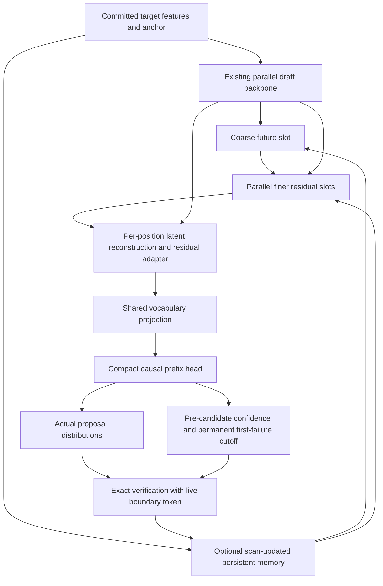

# Astra critical review: persistent-memory NCM draft head

Date: 2026-10-18. Status: **Review and recommended design revision, not an approved architecture or implementation plan.**

## Provenance and scope

The user requested a GPT-6 Astra subagent to critically review NCM retention, sampled confidence-cutoff correctness, parallelism, and accepted-token opportunities. This document preserves and organizes the findings of `/root/astra_architecture_review`, running `gpt-6-astra` with high reasoning effort. The parent agent cross-checked the principal mathematics and local sampled-acceptance and Markov-head code. The architectural sketch below makes the review's recommendation concrete; it does not replace the original draft or assert measured benefits.

Reviewed artifacts:

- [Architecture draft][PLAN], especially §§5–13 and §16. Line references below refer to its 521-line revision reviewed on this date.
- [Preserved GPT-6.1 Sol paper extraction][SOL], especially S1–S5 and S7–S9.
- [Primary NCM PDF][PDF], §3, printed pp. 5–7, and its extracted text; [released NCM implementation][NCM].
- [DSpark paper][DS] and [DFlash paper][DF].
- Local source at `d82ae69d0368478b5018d4cbfa92ab4643a43f54`.

This review changes documentation only. No training, acceptance experiment, serving run, or performance measurement was conducted. Historical memory was consulted for context, but the findings below rest on the cited draft, primary sources, local code, or explicit mathematical derivations.

## Verdict

**Revise the architecture before approving it. Preserve the native cutoff.**

The normative pre-candidate admission loop is correct for sampled decoding under the probability and randomness contracts described below. Its fallback language nevertheless permits an unsafe implementation. Confidence calibration quality and sampling correctness are separate properties.

The proposed memory adapter is a legitimate small architecture, but retains little of NCM's distinctive future residual hierarchy. Its fixed deterministic plan cannot resolve sampled-prefix distinctions that the frozen first-order Markov head discards. Keep it as a simple baseline; make a small future residual planner and a prefix-aware dependency interface the recommended richer design.

## Findings, ranked by importance

| ID | Severity and type | Finding | Required or recommended action |
| --- | --- | --- | --- |
| R1 | P1: missing correctness contract | A whole-request fallback triggered by an unvisited suffix can reopen an earlier cutoff and bias sampling. | Require fallback decisions to obey the same causal admission boundary. |
| R2 | P1 relative to the NCM design goal; performance hypothesis | Temporal EMA slots are not a future coarse-to-fine hierarchy. | Add a short future residual planner, or explicitly select the EMA adapter as the narrower design. |
| R3 | P2: confidence semantics | Products of local overlaps are not exact prefix-survival probabilities, even with perfect local predictions. | Default to conditional confidence; name the product a monotone score unless its calibration contract is specified. |
| R4 | P2: expressivity limit | A fixed plan plus predecessor-only Markov head cannot distinguish sampled prefixes sharing their last token. | Let token and confidence heads consume a compact actual-prefix state. |
| R5 | P2: capacity limitation | Four-value attention gives the anchor only a routing role. | Add a direct anchor/query path and distinct future-slot queries. |
| R6 | P2: training objective | Token cross-entropy leaves acceptance alignment implicit. | Specify distribution-overlap matching alongside token fidelity and future residual supervision. |

### R1. Fallback must obey the stopping rule

**Draft references:** lines 286, 301, 303–323, and 368.

The normal loop decides whether to admit candidate `i` before reading its sampled identity. That is sound. The sentence “Missing/nonfinite confidence selects full verification for that request” is too broad when a fixed-shape implementation computes the entire block first.

Consider this binary counterexample:

1. At position 1, both target and proposal are `p₁=q₁=(1/2,1/2)` over `{A,B}`.
2. The confidence estimate is `c₁=0.2`, below a threshold of `0.5`. The normal policy admits zero drafts.
3. A full-block implementation has nevertheless sampled `Y₁` and computed later confidence values.
4. The second confidence value is nonfinite exactly when `Y₁=A`.
5. A global invalidity check overrides the earlier stop and requests full verification if any value is nonfinite.

When `Y₁=A`, full verification accepts it surely. When `Y₁=B`, the zero-draft path samples a fresh target token. Thus:

```text
P(output=A) = (1/2)*1 + (1/2)*(1/2) = 3/4
target P(A) = 1/2
```

The inaccurate first confidence is harmless by itself. The bias comes from allowing a future observation to change its own predecessor's admission.

**Revision:** distinguish two fallback classes:

- Before drafting, checkpoint/calibration compatibility and supported request-wide sampling settings may select full verification using prefix-only metadata.
- During the admission scan, inspect only the confidence at the next causally visited position. If it is invalid, switch to admitting the remaining suffix from that point, or use another explicitly causal fallback. Do not inspect unvisited values after a stop. An invalid probability distribution itself requires a separate valid proposal/target-only recovery path; a confidence fallback cannot repair invalid `q`.

Apply this rule to nonfinite checks, sampling-support checks, and any other whole-vector validity reduction. **Once stopped, admission cannot reopen.** This is a specification defect permitting a biased implementation, not a claim that the existing normative loop is biased.

### R2. Restore a future residual hierarchy

**Draft references:** lines 36–40, 193–236, and 374–380. **Evidence:** Sol S1–S4 and S7–S8; NCM §3, pp. 5–7.

NCM represents future block content at several resolutions. It predicts coarse content, reconstructs a shared latent, and predicts finer residual information conditioned on that reconstruction. Predictions within a level are parallel; levels are sequential. Sampled coarse codes additionally couple later draws through shared randomness.

The draft's four EMA slots summarize different durations of the past. They do not represent future residual levels. Its single deterministic vector provides common features but creates no stochastic dependence between otherwise independent output draws. The Markov head remains responsible for sampled-token dependence.

The draft already acknowledges this distinction; the review is questioning design value, not attribution. Avoiding the complete NCM generator is sensible. However, NCM's weak shallow standalone results do not establish that a small target-conditioned future planner is useless. The Sol summary explicitly distinguishes those problems and records the absence of validated one-to-three-level results.

**Revision:** retain the EMA adapter as a simple baseline. For the richer architecture, predict one coarse future slot, then several finer residual slots, and reconstruct per-position planning features. Supervise their future roles rather than assuming any bottleneck vector learns planning automatically. Start with continuous deterministic slots; this borrows progressive future structure without claiming to reproduce residual VQ or NCM's stochastic factorization.

### R3. Local overlap and prefix survival need distinct names

**Draft references:** lines 264–284 and 296–299.

The quantity

```text
a_i(y_<i) = sum_v min(p_i(v | y_<i), q_i(v | y_<i))
```

is the acceptance probability of the next draw from `q_i`, at that fixed prefix. Multiplying these values along a sampled path does not retrospectively account for how likely its earlier specific candidates were to pass rejection tests.

The parent independently checked this strictly positive-support example with exact rational arithmetic:

```text
p_1(A,B) = (0.9, 0.1)
q_1(A,B) = (0.5, 0.5)
a_1      = 0.6

after A: p_2 = q_2, so a_2(A) = 1
after B: p_2 = (0.1,0.9), q_2 = (0.9,0.1), so a_2(B) = 0.2

true two-draft survival = min(0.9,0.5)*1 + min(0.1,0.5)*0.2 = 0.52
E_q[a_1*a_2(Y_1)]       = 0.6*(0.5*1 + 0.5*0.2)          = 0.36
```

For a fully realized path, survival over independent acceptance coins is the product of its candidate-specific ratios `min(1,p_j(y_j)/q_j(y_j))`. Before drawing candidate `i`, conditional on the earlier candidates, survival through `i` is the product of those earlier ratios times the next-position overlap. Before observing the block, integrate over proposal paths.

The draft already disclaims exactness at line 284. Its remaining gap is a concrete meaning for “calibrated prefix forecast”: which information is conditioned on, which event supplies the labels, and which deployed selection policy defines the calibration population.

**Revision:** make `conditional_acceptance` the default threshold semantics. Keep the product as `monotone_admission_score`, with no inherent probability guarantee. If probability-valued prefix survival is required, define a direct predictor of survival through `i`, using only features available before drawing `y_i`, trained against survival outcomes or the corresponding soft probability labels. Those labels may use target probabilities offline; the runtime predictor may not.

A direct forecast may rise when a favorable earlier candidate becomes known. It need not be numerically monotone. Permanent first-failure stopping still produces a contiguous prefix. Any calibration must be tied to the proposal, sampling regime, and policy-relevant prefix distribution; held-out reliability does not make an algebraic identity true.

**This affects interpretation and efficiency, not exactness:** a causal threshold on an imperfect score remains safe under the verifier contract.

### R4. Expose the actual sampled prefix to both heads

**Draft references:** lines 232, 245–254, and 374. **Code:** [Markov head][MARKOV].

At a fixed committed prefix, the draft currently has the form:

```text
q_i(v | Y_<i) = softmax(U_i(v) + B(Y_(i-1), v))
```

The deterministic plan and parallel backbone features are fixed before drafting. Two candidate histories ending in the same token receive the same next-token proposal at the same position.

For a target that generates either `A C A` or `B C B`, the third token must remember the first. A predecessor-only head sees `C` in both cases. A compact prefix state can preserve the distinction. Current `compute_step_bias` discards its `hidden_states` argument and projects the preceding token's embedding, making the limitation concrete.

**Revision:** define a compact `prefix_state` in the dependency-head interface and feed it to confidence as well as token logits. A Markov embedding remains one implementation; a trainable small recurrent state is another. The confidence branch's causal interface survives replacement, but a predictor seeing only the predecessor need not represent the new proposal's acceptance variation.

This is an expressivity argument, not a guarantee of a large gain. DSpark's recurrent alternative reportedly adds only modest gains, especially at longer widths; keep the extra serial cost visible. [DSpark §4.3.2][DS]

### R5. Avoid a four-value routing bottleneck

**Draft references:** lines 199–207.

The anchor and latest feature only determine attention weights over four memory values. If those values coincide, changing the anchor cannot change the weighted sum. This happens after the first ingested token, when all mass-normalized EMA slots equal that token's feature; scale embeddings affect keys but not the value-side limitation.

The baseline hidden states still contain anchor information, so this is not an overall loss of anchor conditioning. It is a limitation of interpreting `z` as a future predictor.

**Revision:** include a direct query/anchor residual, for example an MLP over the query and retrieved memory. Give finer future slots distinct position or segment queries. Let them retrieve from multiple memory values rather than forcing every future position through one pooled vector. All such reads can run in parallel within a planning stage.

### R6. Specify acceptance-aligned learning

**Draft references:** lines 374–380.

Cross-entropy is legitimate, but under limited model capacity its optimum need not maximize proposal/target overlap. Confidence supervision already uses overlap; the token branch should have an explicit matching objective too.

**Revision:** define three roles without choosing schedules or weights: token fidelity, target/proposal distribution matching, and future residual-plan supervision. DSpark's TV objective is a direct precedent for the second role. [DSpark §3.3][DS]

Training must use the actual proposal transformation and appropriate draft prefixes. A future-label encoder must be fixed or otherwise constrained against collapse; future states are labels, never inference inputs. Planner training should account for its own imperfect predicted coarse states, not only clean teacher plans. Sol S2 provides the exposure-mismatch motivation; the exact remedy remains a new design choice.

## Sampled correctness: what is proved and what is not

### Predictable stopping preserves the target distribution

At position `i`, let the available information contain the committed prefix, fixed draft-side plans, earlier candidate tokens, and admissible scheduler metadata. Admission must be decided using that information before the candidate draw. The proposal must actually sample from the normalized `q_i` passed to verification, including all sampling transformations.

At an admitted position, for any token `v`:

```text
accepted-candidate probability mass = min(p_i(v), q_i(v))
rejected-and-corrected mass         = max(p_i(v) - q_i(v), 0)
sum                                = p_i(v)
```

Correction samples normalized positive residual mass when rejection occurs. A cutoff instead produces a valid target sample at the boundary. With the required independent randomness and proper state handling, induction over emitted tokens proves exactness despite a random, prefix-dependent stopping time.

Consequences:

- Full physical pre-drafting is permitted if logically equivalent to this causal process. The final width may depend on earlier admitted candidates.
- A shorter rerun of a bidirectional drafter may change its proposal. Do not replace the stored probabilities unless the candidate sampling process is changed consistently.
- Calibration is not part of the exactness proof.
- Non-anticipation is the condition for this general guarantee with the unchanged verifier. More elaborate selection-aware samplers could have different contracts; they are outside this design.
- Suffix-dependent retrospective admission violates this guarantee; DSpark discusses this in §3.2.2 and Appendix A. [DSpark][DS]

### The existing sampled cap has a valid boundary-token construction

The local [acceptance implementation][ACCEPT] runs chain rejection, caps the accepted count, then gathers `predicts[accept_index[capped_count]]`. The [rejection kernel][REJECT] writes accepted candidates and the eventual correction into that structure.

If verification reaches beyond the cutoff, the gathered boundary token is either the next candidate accepted by its rejection test or its residual correction. That mixture is target-distributed by the identity above. If rejection occurs earlier, the ordinary correction remains. Therefore a predictable cutoff plus valid boundary probabilities can make this construction exact.

This is materially different from keeping a bonus sampled at a farther, discarded prefix. The draft correctly says that count capping alone is not a proof; the revision should also recognize the valid corrected-boundary construction.

This reasoning does not validate every backend, dead-row mask, numerical edge case, or actual work saving. The implementation still needs a valid live boundary row. Merely discarding fully computed suffix outputs does not meet the user's verification-cost objective.

### Shared stochastic plans: exactness is possible, acceptance is not assured

A prefix-sampled latent `Z` may be fixed for the proposal, with verification using the actual conditional distribution `q_i(. | Z,Y_<i)`. Exactness does not require marginalizing all latent values. A plan cannot be revised using a candidate while pretending that candidate was sampled under the revised proposal.

However, overlap is concave in the proposal, so at a fixed first-position prefix:

```text
E_Z[overlap(p,q_Z)] <= overlap(p,E_Z[q_Z])
```

A sharp example is a target uniformly choosing `AA` or `BB`. A latent choosing one mode and drafting it deterministically matches the target's marginal joint distribution. Conditional-latent verification nonetheless accepts its first token with probability 1/2. Both drafts survive together or neither does, giving one expected accepted draft. An independent uniform two-position proposal accepts the first surely and the second with probability 1/2, giving 1.5 expected accepted drafts.

Thus more coherent samples can produce fewer accepted tokens. This is not a universal argument against stochastic plans; it rules out coherence alone as evidence of an acceptance gain. A small mixture using exact component posterior updates can avoid some conditional-proposal penalties, but must evaluate the actual marginal conditional proposal and pay its computation cost. The lower-risk recommendation is a deterministic residual planner first.

## Recommended revised architecture

This is the concrete direction recommended by the review, not an approval or a complete replacement specification.



1. **Context and memory.** Preserve the existing detailed target-feature context. Keep committed-only memory lifecycle, watermarking, normalized recurrences, and bounded state. Treat memory as an additional context path whose value remains unproved. DFlash already uses target features throughout its draft context. [DFlash §4.1][DF]
2. **Future residual planner.** After one backbone pass, predict a coarse future slot from pooled backbone features, memory, and a direct anchor path. A second small stage predicts multiple finer residual slots in parallel. Reconstruct a per-position latent and inject it before the existing vocabulary projection. One coarse slot plus four finer slots is a concrete candidate shape, not a paper-derived optimum.
3. **Learning contract.** Define future targets that give coarse and residual slots distinct roles. Use only predictions at inference. Keep a direct token path so the plan need not reconstruct the entire vocabulary sequence by itself. Include token and distribution-matching objectives; auxiliary reconstruction alone is insufficient.
4. **Prefix dependency.** Let a compact state summarize the actual sampled prefix. Use one output correction projection per step, replacing rather than automatically duplicating the current Markov correction. A Markov realization remains the cheapest supported option.
5. **Confidence.** Feed the same actual-prefix state, planning features, and sampling metadata to a detached confidence branch. Predict next-candidate acceptance before sampling that candidate. Default to a conditional threshold; retain other explicitly named causal policies.
6. **Verification.** Freeze the proposal's probability semantics, keep permanent first-failure admission, and implement the corrected boundary sample. Preserve real suffix work suppression and committed-only memory writes.

An illustrative deterministic planner is:

```text
context = concat(anchor_projection, latest_feature, retrieved_memory)
coarse  = P_coarse(context, pool(backbone_features))
fine[j] = P_residual(context, pool_segment_j(backbone_features), coarse, slot_id_j)
plan[i] = coarse_reconstruction[i] + sum_j reconstruction_weight[i,j] * fine[j]
```

All `fine[j]` computations occur in parallel after `coarse`. Both stages finish before any token draw, so they do not violate admission causality. These equations alone do not guarantee residual specialization: the supervision and reconstruction constraints must define it. They are a compact continuous adaptation of an idea, not an implementation of NCM's residual quantizer.

## Opportunities for parallelism and longer accepted prefixes

| Priority | Opportunity | Potential benefit | Limit or cost |
| --- | --- | --- | --- |
| 1 | Batch projection of committed features; affine memory scan/reduction | Avoid per-token host and kernel serialization, especially during prefill | Preserve exact token order, logical boundaries, and numerical tolerance. |
| 2 | Parallel finer slots and parallel per-position adapters | Add future coordination with only two small latent stages | Adds serial latent-stage latency; no measured acceptance gain. |
| 3 | Prefix-aware output state | Preserve sampled dependencies beyond the predecessor and improve later proposals | Candidate generation remains sequential when later proposals depend on actual earlier draws. |
| 4 | Share compact features across token and confidence heads; precompute frozen token-embedding projections | Reduce redundant work in the serial output loop | Vocabulary corrections, sampling, and tensor-parallel communication may still dominate. |
| 5 | Position-specific memory reads and direct anchor path | Retain distinctions lost by one shared weighted average | More small operations; detailed context may already encode the same information. |
| 6 | Allow limited adaptation inside the draft backbone/context projection | Remove a frozen final-adapter capacity ceiling | Broader training scope and possible additional inference cost. |
| 7 | Fully parallel conditional-independent token option | Remove the serial sampled-prefix chain | Sacrifices dependencies; a shared deterministic plan does not make draws dependent. |
| 8 | Small marginalized plan mixtures or tree proposals | Cover more plausible continuations | Requires explicit proposal/verification semantics and more compute; candidate selection can bias sampling. |

For the EMA update, represent each token as an affine map `m -> A*m+b`. Composition is associative:

```text
(A2,b2) after (A1,b1) = (A2*A1, A2*b1+b2)
```

This supports prompt scans and committed-chunk reductions for both accumulators and normalization masses. The recurrence need not become a serial Python loop. Floating-point reassociation may change roundoff; preserve the logical update and specify tolerances rather than promising bitwise identity.

A recurrent prefix head can be parallelized over known teacher-forced tokens during training if its chosen algebra permits it. That does not remove the inference dependency on tokens not yet sampled. Likewise, packing all latent levels into one training pass does not make dependent latent stages parallel at inference; Sol S2–S3 explicitly distinguish this for NCM.

There is no evidence here that simply increasing proposal width will increase useful accepted tokens enough to pay for verification. The meaningful design objective remains committed progress per draft-plus-verify time. Report accepted-prefix lengths and cost separately when experiment design is eventually authorized; this review does not choose that experiment.

## Decisions to resolve in the next architecture revision

- Select the narrow EMA baseline or the richer deterministic future residual planner as the primary design. The review recommends the latter for the stated NCM goal.
- Make conditional acceptance the default threshold, or specify a direct prefix-survival predictor with its information set and labels. Do not silently give the current product exact probability semantics.
- Specify the causal fallback state machine and boundary-token contract explicitly.
- Decide whether the first richer dependency implementation remains Markov or uses compact recurrent state; expose the state in both token and confidence interfaces regardless.
- Define future residual targets and acceptance-aligned learning objectives before selecting a training protocol.
- Preserve the current draft as the reviewed baseline until those changes are accepted. No implementation or experiment is implied by this review.

[PLAN]: /Users/dnikolaidis/Desktop/divix/sglang-nvfp4/docs/hx/ncm-persistent-memory-head.draft.md
[SOL]: /Users/dnikolaidis/Desktop/divix/sglang-nvfp4/docs/research/ncm-paper-sol-summary-2026-10-18.md
[PDF]: /Users/dnikolaidis/Desktop/ncm.pdf
[NCM]: https://github.com/HazyResearch/ncm/tree/c70274273f489abc73832b2b98584a8483b6b203
[DS]: https://arxiv.org/html/2607.05147v1
[DF]: https://arxiv.org/html/2602.06036v1
[MARKOV]: /Users/dnikolaidis/Desktop/divix/sglang-nvfp4/python/sglang/srt/models/deepseek_v4_dspark.py:476
[ACCEPT]: /Users/dnikolaidis/Desktop/divix/sglang-nvfp4/python/sglang/kernels/ops/speculative/dspark/dspark_accept.py:150
[REJECT]: /Users/dnikolaidis/Desktop/divix/sglang-nvfp4/python/sglang/kernels/ops/speculative/reject_sampling.py:79
